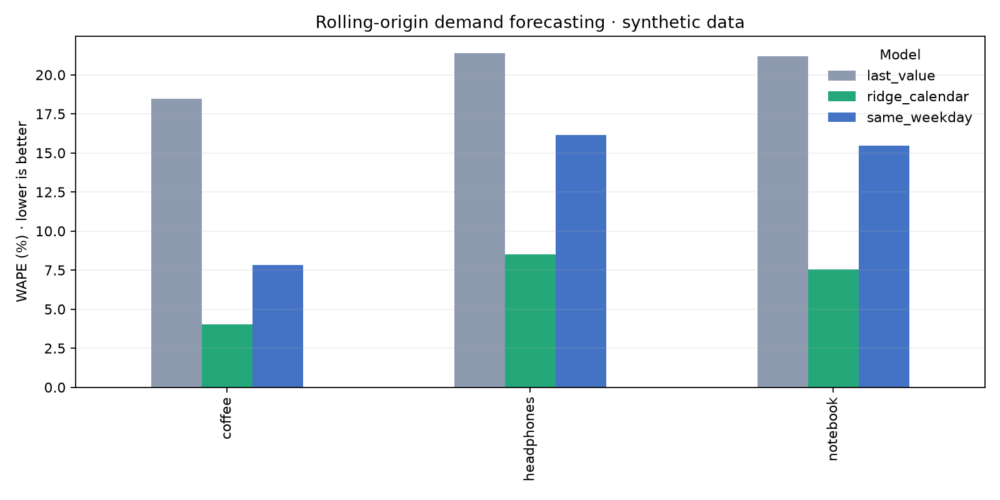

# Forecast Lab

A reproducible **retail demand forecasting benchmark** in Python. It compares last-value, same-weekday, and ridge-regression forecasts using rolling-origin backtests. The report includes MAE, WAPE, bias, per-SKU results, and a comparison chart.

## Why it matters

A low error score means little if a model accidentally sees the future. Each fold trains only on dates before its forecast window. The regression uses only information available at forecast time: calendar date and a known promotion plan. The baseline models set a practical bar for the learned model.

## Run it

Windows PowerShell (Python 3.11+):

```powershell
python -m venv .venv
.\.venv\Scripts\python.exe -m pip install -r requirements.txt
.\.venv\Scripts\python.exe -m forecast_lab
```

macOS/Linux:

```bash
python3 -m venv .venv
. .venv/bin/activate
python -m pip install -r requirements.txt
python -m forecast_lab
```

The command generates **fictional** data for three SKUs and writes `reports/scores.csv`, `reports/predictions.csv`, `reports/synthetic_sales.csv`, and `reports/model_comparison.png`. The random seed is fixed so the example is reproducible.



In the bundled synthetic example, the learned model reaches 4.0–8.5% WAPE across the three items, compared with 18.5–21.4% for the last-value baseline. These numbers describe only this generated dataset.

To evaluate your own daily data:

```bash
python -m forecast_lab --data path/to/daily_sales.csv --out reports/my_run \
  --min-train 180 --horizon 28 --step 28
```

Input columns: `date` (YYYY-MM-DD), `sku` (item ID), `units` (nonnegative quantity), `promo` (`0` or `1`). Each SKU needs continuous daily dates and at least `min_train + horizon` rows. Promotion values must be known at prediction time. See [`data/sample.csv`](data/sample.csv) for the format.

Run tests with your virtual environment's Python: `python -m pip install -r requirements-dev.txt && python -m pytest -q` (use `.\.venv\Scripts\python.exe` in place of `python` on Windows PowerShell).

## Evaluation choices

| Model | Forecast for a 28-day window |
| --- | --- |
| Last value | Repeat the last observed demand |
| Same weekday | Repeat demand from the last matching weekday |
| Ridge calendar | Predict from time trend, weekday, and planned promotion |

**MAE** is the mean absolute unit error. **WAPE** is `sum(abs(error)) / sum(actual)`, expressed as a percentage. **Bias** is mean `(forecast - actual)`; positive values mean overforecasting. WAPE is undefined when actual demand totals zero, so the report leaves that value empty.

The demo illustrates the method, not production accuracy. Real deployments need stockout handling, holidays, promotion quality checks, uncertainty intervals, and drift monitoring.

## Project structure

- `forecast_lab/core.py`: data checks, models, time-based backtesting, metrics
- `forecast_lab/__main__.py`: CLI and report generation
- `tests/`: regression checks, including a future-target leakage test

This is an independent portfolio project built with synthetic data. It contains no employer records or proprietary code.
